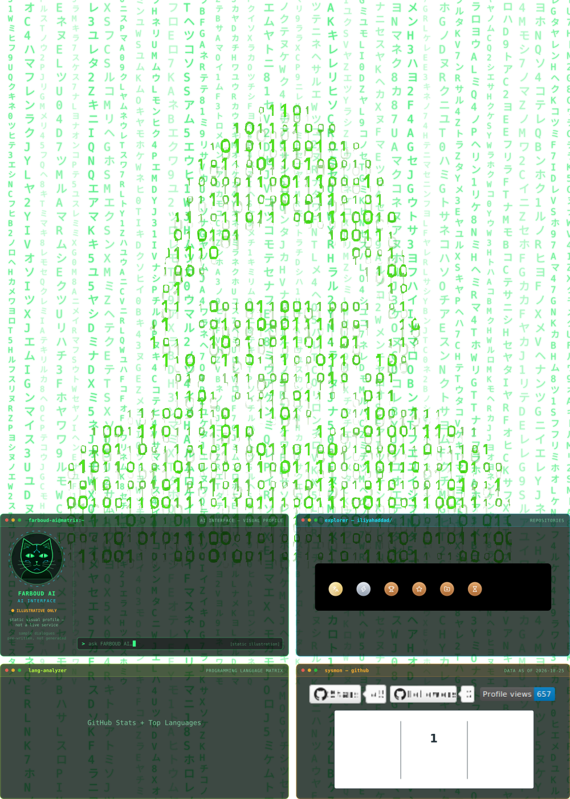

# Matrix GitHub Profile — iliyahaddad

این بسته SVG پروفایل Matrix را نگه می‌دارد و سه پنجره را روزانه با داده‌های GitHub به‌روزرسانی می‌کند.

## نصب
1. فایل‌ها را در ریشه repository پروفایل خود (`iliyahaddad/iliyahaddad`) قرار بده.
2. پوشه `.github/workflows/` و `.github/scripts/` را با همین ساختار حفظ کن.
3. در GitHub وارد **Settings → Actions → General → Workflow permissions** شو و گزینه **Read and write permissions** را فعال کن.
4. از **Actions → Refresh GitHub profile SVG → Run workflow** یک بار اجرا کن. پس از موفقیت، SVG با تصاویر آمار واقعی ساخته می‌شود و هر روز خودکار تازه می‌شود.
5. در README پروفایل این خط را قرار بده:

```md

```

پنجره `farboud-ai@matrix:~` و باران/آدمک دست‌نخورده‌اند. اندازه و قاب چهار پنجره حفظ شده است. اگر یکی از سرویس‌های کارت آمار موقتاً در دسترس نباشد، اجرای workflow خطا می‌دهد و فایل قبلی سالم می‌ماند.
